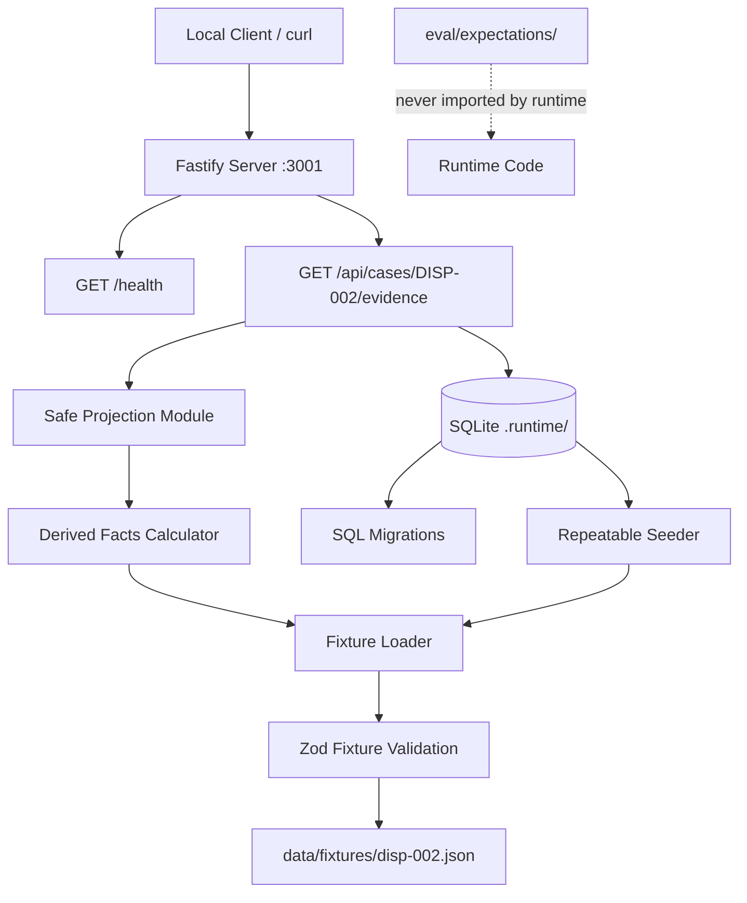

## Product Overview

FareEnough is a dispute-resolution prototype for the Tencent/Ryde Multi-Agent Autonomous Dispute Resolution challenge. This task implements only the **backend foundation** for the no-show vertical slice (DISP-002), establishing the server, database, evidence fixtures, schemas, deterministic calculations, and safe projections that future AI agent work will build upon.

## Core Features

- **TypeScript Fastify backend** with typed routes, Zod validation, and Windows-compatible scripts
- **Local SQLite database** with SQL migrations and repeatable seeding (cases, evidence_items, policy_bundles)
- **DISP-002 evidence fixture** extracted from the organizer sample dataset as runtime JSON — containing dispute metadata, trip data, GPS telemetry, chat logs, app events, and cancellation policy only
- **Answer-key isolation**: the expected ruling ("Cancellation charge UPHELD") and the editorial "Evidence Summary" table are excluded from all runtime data; they belong only in `eval/expectations/`
- **Zod schemas** validating the fixture structure and all API response boundaries
- **GET /health** endpoint returning backend/database readiness
- **Safe case/evidence projection endpoint** for DISP-002 that excludes historical rider/driver profiles (ratings, dispute history, fraud flags) per NFR-10/ACC-04
- **Deterministic waiting duration calculation** computing 480 seconds from `driver_wait_start` (08:43:00+08:00) to `cancellation_time` (08:51:00+08:00) in code, not hardcoded
- **Tests** for fixture validation, 480-second calculation accuracy, and answer-key leakage prevention
- **Existing frontend preserved** — no modifications to `frontend/` directory, no AI agents, no UI changes


## Tech Stack Selection

All choices align with SRS §13.1 recommended stack and the existing project:

| Layer | Selection | Rationale |
| --- | --- | --- |
| Language | TypeScript 5.x | SRS §13.1: shared types across app and backend |
| Runtime | Node.js 24 LTS (verified v24.19.0) | SRS §13.1; already installed |
| Backend framework | Fastify 5 | SRS §13.1: typed routes, validation, testing |
| Database | SQLite via `better-sqlite3` | SRS §13.1: durable local state, transactional safety |
| Schema validation | Zod 3 | SRS §13.1: validate API, fixture, and tool boundaries |
| Testing | Vitest 2 | SRS §13.1: unit/integration with Fastify injection |
| Package manager | npm 11 (verified 11.17.0) | SRS §13.1: npm workspaces |
| Build | `tsx` for dev, `tsc` for build | Standard TS dev/build pipeline |

## Implementation Approach

### Strategy

Create an npm workspace monorepo with a root `package.json` managing a `backend/` package. The backend uses Fastify with `better-sqlite3` for persistence. The DISP-002 JSON evidence is extracted into `data/fixtures/disp-002.json` containing only the evidence blocks (no expected ruling, no editorial summary). Zod schemas validate the fixture at load time and shape all API responses. A deterministic calculation module computes the waiting duration from ISO 8601 offset-aware timestamps. A safe projection module strips historical profile data before returning case/evidence to any endpoint consumer.

### Key Technical Decisions

1. **Workspace structure**: Root `package.json` with `"workspaces": ["backend"]` rather than the full SRS §13.4 target (which includes `apps/web`, `packages/contracts`). This slice only needs the backend; the frontend remains standalone. The structure is forward-compatible — adding `apps/web` and `packages/contracts` later requires moving the backend into `apps/server`, but the schemas and patterns will transfer directly.

2. **`better-sqlite3` over `sql.js`**: SRS §13.1 explicitly recommends `better-sqlite3`. It is synchronous, fast, and supports transactions natively. The SRS warns to "verify the chosen SQLite package build on the team's Windows machines in the first setup milestone" — `better-sqlite3` ships prebuilt binaries for Windows/Node 24 via `prebuild-install`, so no native compilation is needed in the common case.

3. **Fixture extraction**: The DISP-002 JSON block (lines 12-233 of the sample MD) is extracted verbatim into `data/fixtures/disp-002.json`. The "Expected ruling" header (line 5) and "Evidence Summary" table (lines 238-250) are deliberately omitted. The expected ruling goes into `eval/expectations/disp-002.json` as an evaluation-only asset, never imported by runtime code.

4. **Safe projection**: Per SRS §11.3, `rider_profile` and `driver_profile` are "preserved; pseudonymous operational IDs; adjudication projection excludes historical and personal attributes." The fixture retains the full profiles (for provenance), but the API projection strips `avg_rating`, `dispute_history`, `fraud_flags`, `fraud_flag_details`, `account_age_days`, `total_trips` — exposing only `rider_id`/`driver_id` as pseudonymous identifiers.

5. **Deterministic calculation**: The waiting duration is computed by parsing `driver_wait_start` and `cancellation_time` as ISO 8601 strings with `+08:00` offset, converting to epoch milliseconds, and taking the difference in seconds. This is timezone-correct (both timestamps share the same offset, so no DST issues). The result is 480 seconds. The calculation module also produces a `DerivedFact` object per SRS §11.2 `DerivedFact` interface, carrying `sourceEvidenceIds`, `calculationVersion`, `unit`, and `warnings`.

6. **Migration approach**: SQL migration files run sequentially, tracked in a `schema_migrations` table. The seed is idempotent — it checks for existing DISP-002 case/evidence rows before inserting, using `INSERT OR IGNORE` on unique constraints.

### Performance & Reliability

- **Database**: `better-sqlite3` is synchronous and in-process — no connection pool needed. SQLite WAL mode enabled for read concurrency. All queries use parameterized statements (NFR-13). The DISP-002 fixture has ~8 GPS points, ~6 chat logs, ~10 app events — trivially small.
- **Time complexity**: Waiting duration calculation is O(1) — two timestamp parses and one subtraction. Fixture validation is O(n) where n = number of evidence items (~24). All sub-millisecond.
- **Bottleneck**: None for this slice. The data volume is tiny. Future agent runs will be the bottleneck, handled in later slices.

### Avoiding Technical Debt

- Reuse SRS §11.2 TypeScript interface shapes as the basis for Zod schemas (DerivedFact, EvidenceItem, PolicyBundle) — forward-compatible with future agent work.
- Follow SRS §13.4 target directory structure where practical (`data/fixtures/`, `data/policies/`, `eval/expectations/`, `.runtime/`).
- Keep the frontend's `node frontend/serve.mjs` command working independently — the root package.json scripts do not interfere.

## Implementation Notes

### Grounded Patterns
- The existing frontend uses `127.0.0.1:3000` — the backend should default to the same host but a different port (`3001`) to avoid conflicts, with the documented expectation that a proxy will unify them later (SRS §14: "Development may use separate Vite/Fastify ports with a proxy").
- The existing frontend test uses `node --test` (built-in test runner). The backend uses Vitest per SRS §13.1. Both can coexist.
- SRS §14 OPS-01 requires specific script names. The root `package.json` should expose: `npm run dev` (tsx watch), `npm run build` (tsc), `npm start` (compiled server), `npm run db:migrate`, `npm run seed`, `npm test` (vitest). The frontend's existing `node frontend/serve.mjs` remains documented separately.

### Performance
- No hot paths in this slice. All operations are single-row lookups on a local SQLite file.
- `better-sqlite3` prepared statements are cached by the driver — no manual statement pooling needed.

### Logging
- Use Fastify's built-in logger (`pino`). Log at `info` for server start/stop, `error` for failures. Never log `MODEL_API_KEY` or fixture content (NFR-12). Health endpoint does not log on each request.

### Blast Radius Control
- The `frontend/` directory is completely untouched. No imports from backend to frontend or vice versa.
- The `.runtime/` directory is gitignored — SQLite file lives there, created on first migrate/seed.
- `.env.example` contains only non-secret placeholders per SRS §14 OPS-02.
- No existing files are modified. Only new files are created, plus a root `package.json` (which does not exist yet).

## Architecture Design

### System Structure



### Component Relationships

- **Fastify server** (`src/server.ts`): Creates the Fastify instance, registers routes, starts listening on `127.0.0.1:3001`.
- **Routes** (`src/routes/`): `health.ts` (GET /health), `cases.ts` (GET /api/cases/:id/evidence). Each route uses Zod to validate path params and shape responses.
- **Fixture loader** (`src/fixtures/loader.ts`): Reads `data/fixtures/disp-002.json`, validates with Zod, caches in memory.
- **Safe projection** (`src/projections/case-projection.ts`): Transforms raw fixture into a safe response object, stripping historical profile data, adding derived facts.
- **Derived facts calculator** (`src/calculations/waiting-duration.ts`): Pure function taking `driver_wait_start` and `cancellation_time` ISO strings, returning a `DerivedFact` with `value: 480`, `unit: "seconds"`.
- **Database** (`src/db/`): `connection.ts` (opens `better-sqlite3`), `migrate.ts` (runs SQL files), `seed.ts` (idempotent insert of DISP-002).
- **Schemas** (`src/schemas/`): Zod schemas for fixture, API responses, and derived facts.

### Data Flow

1. Server starts → runs migrations → optionally seeds
2. `GET /health` → checks DB connection → returns `{ status: "ok", database: true, provider: false }`
3. `GET /api/cases/DISP-002/evidence` → loads fixture (memory-cached) → computes waiting duration → applies safe projection (strips historical profiles) → returns validated JSON response

## Directory Structure Summary

All files are NEW. No existing files are modified. The `frontend/` directory and all docs remain untouched.

```
FareEnough/                          # existing repo root
├── package.json                     # [NEW] Root workspace package.json with scripts
├── tsconfig.base.json               # [NEW] Shared TS config (strict, ES2022, NodeNext)
├── .env.example                     # [NEW] Non-secret env placeholders per SRS OPS-02
├── .gitignore                       # [NEW] Ignores .runtime/, node_modules/, dist/
├── backend/                         # [NEW] Backend workspace package
│   ├── package.json                 # [NEW] Backend deps: fastify, better-sqlite3, zod, tsx, vitest
│   ├── tsconfig.json                # [NEW] Extends base, includes src/, excludes dist/
│   ├── src/
│   │   ├── server.ts                # [NEW] Fastify instance creation, route registration, listen on 127.0.0.1:3001
│   │   ├── config.ts                # [NEW] Reads env vars (PORT, DATABASE_PATH, APP_MODE, AI_MODE); safe defaults
│   │   ├── routes/
│   │   │   ├── health.ts            # [NEW] GET /health — returns {status, database: boolean, provider: boolean}; no keys, no model probe
│   │   │   └── cases.ts             # [NEW] GET /api/cases/:id/evidence — loads fixture, computes derived facts, returns safe projection
│   │   ├── schemas/
│   │   │   ├── fixture.ts           # [NEW] Zod schemas for the DISP-002 fixture: DisputeTicket, TripData, GpsTelemetry, ChatLog, AppEvent, CancellationPolicy, RiderProfile, DriverProfile, Disp002Fixture
│   │   │   ├── api.ts               # [NEW] Zod schemas for API responses: HealthResponse, CaseEvidenceResponse, SafeTripData, SafeRiderRef, SafeDriverRef, DerivedFactResponse
│   │   │   └── derived-fact.ts      # [NEW] Zod schema for DerivedFact per SRS §11.2 (id, name, value, unit, sourceEvidenceIds, calculationVersion, status, warnings)
│   │   ├── fixtures/
│   │   │   └── loader.ts            # [NEW] Loads and validates data/fixtures/disp-002.json with Zod; caches result; throws on validation failure
│   │   ├── calculations/
│   │   │   └── waiting-duration.ts  # [NEW] Pure function: takes ISO 8601 start/end strings, returns DerivedFact with value=480, unit="seconds", calculationVersion="1.0.0"; uses epoch ms diff
│   │   ├── projections/
│   │   │   └── case-projection.ts   # [NEW] Transforms validated fixture into safe API response; strips rider_profile/driver_profile historical fields; keeps only pseudonymous IDs; attaches derived facts
│   │   ├── db/
│   │   │   ├── connection.ts        # [NEW] Opens better-sqlite3 at config.DATABASE_PATH; enables WAL; exports db instance
│   │   │   ├── migrate.ts           # [NEW] Reads and applies SQL files from src/db/migrations/ in order; tracks applied in schema_migrations table
│   │   │   ├── seed.ts              # [NEW] Idempotent: checks if DISP-002 case exists; if not, inserts case + evidence items + policy bundle; safe to re-run
│   │   │   └── migrations/
│   │   │       ├── 001-init.sql     # [NEW] Creates tables: schema_migrations, cases, evidence_items, policy_bundles; with unique constraints
│   │   │       └── 002-seed-disp002.sql  # [NEW] INSERT OR IGNORE for DISP-002 case row, evidence item rows, organizer policy bundle row
│   │   └── index.ts                 # [NEW] Entry point: imports server, runs migrate on startup, starts listening
│   └── tests/
│       ├── fixture-validation.test.ts  # [NEW] Validates disp-002.json passes Zod fixture schema; tests field types, required fields, GPS array ordering
│       ├── waiting-duration.test.ts    # [NEW] Tests 480-second calculation from 08:43 to 08:51; tests edge cases (same time=0, reversed input throws/negative check); tests DerivedFact shape
│       ├── answer-key-leakage.test.ts  # [NEW] Scans all runtime files (data/fixtures/, src/) for "UPHELD", "Expected ruling", "Evidence Summary", "expected_ruling"; asserts none found; scans API response JSON
│       ├── health.test.ts              # [NEW] Tests GET /health returns 200 with {status:"ok", database:true, provider:false}
│       └── case-evidence.test.ts       # [NEW] Tests GET /api/cases/DISP-002/evidence returns 200; response contains trip data, GPS, chat, app events, policy, derived facts; response does NOT contain avg_rating, dispute_history, fraud_flags
├── data/
│   ├── fixtures/
│   │   └── disp-002.json            # [NEW] Raw JSON evidence extracted from sample dataset (dispute_ticket through cancellation_policy only); NO expected ruling, NO editorial summary
│   └── policies/
│       └── organizer-disp002-v1.json  # [NEW] Policy bundle per SRS §6.2: profile ID, version, free_wait=300s, no_show_threshold=480s, wait_anchor=driver_wait_start, currency=SGD, fee=500 cents; namespaces: organizer_rule + demo_interpretation
├── eval/
│   └── expectations/
│       └── disp-002.json            # [NEW] Answer key ONLY: {caseId:"DISP-002", expectedDisposition:"claim_rejected", expectedFeeTreatment:"upheld", expectedWaitSeconds:480}; never imported by runtime code
├── .runtime/                        # [NEW, gitignored] SQLite file created here on migrate/seed
└── (existing files unchanged)
    ├── frontend/                    # UNTOUCHED
    ├── README.md                    # UNTOUCHED
    ├── SRS.md                       # UNTOUCHED
    └── docs/                        # UNTOUCHED
```

## Key Code Structures

### DerivedFact schema (Zod, based on SRS §11.2)

```typescript
const DerivedFactSchema = z.object({
  id: z.string(),
  name: z.string(),
  value: z.union([z.number(), z.string(), z.boolean(), z.null()]),
  unit: z.string().nullable(),
  sourceEvidenceIds: z.array(z.string()),
  calculationVersion: z.string(),
  policyRuleIds: z.array(z.string()),
  status: z.enum(["established", "uncertain", "not_applicable"]),
  warnings: z.array(z.string()),
});
```

### Waiting duration calculation signature

```typescript
function calculateWaitingDuration(
  waitStartIso: string,      // e.g. "2026-09-13T08:43:00+08:00"
  cancellationTimeIso: string, // e.g. "2026-09-13T08:51:00+08:00"
  sourceEvidenceIds: string[],
  policyRuleIds: string[],
): DerivedFact;
// Returns: { id: "derived_wait_duration", name: "waiting_duration", value: 480, unit: "seconds", ... }
```

### Safe case evidence response schema (Zod)

```typescript
const CaseEvidenceResponseSchema = z.object({
  caseId: z.string(),
  dispute: z.object({
    disputeId: z.string(),
    tripId: z.string(),
    filedBy: z.enum(["rider", "driver"]),
    disputeType: z.string(),
    description: z.string(),
    filedAt: z.string(),
    status: z.string(),
  }),
  trip: z.object({
    tripId: z.string(),
    riderId: z.string(),         // pseudonymous only
    driverId: z.string(),        // pseudonymous only
    pickupLocation: z.object({ name: z.string(), lat: z.number(), lng: z.number() }),
    dropoffLocation: z.object({ name: z.string(), lat: z.number(), lng: z.number() }),
    scheduledTime: z.string(),
    driverArrivalTime: z.string(),
    driverWaitStart: z.string(),
    cancellationTime: z.string(),
    cancellationFee: z.number(),
    cancellationReason: z.string(),
  }),
  gpsTelemetry: z.array(z.object({
    timestamp: z.string(), lat: z.number(), lng: z.number(),
    speedKmh: z.number(), status: z.string(),
  })),
  chatLogs: z.array(z.object({
    timestamp: z.string(), sender: z.string(), type: z.string(), content: z.string(),
  })),
  appEvents: z.array(z.object({
    timestamp: z.string(), eventType: z.string(), details: z.string(),
  })),
  cancellationPolicy: z.object({
    freeWaitTimeMin: z.number(),
    cancellationFeeAfterWait: z.number(),
    noShowThresholdMin: z.number(),
    feeGoesTo: z.string(),
  }),
  derivedFacts: z.array(DerivedFactSchema),
  policyProfile: z.object({
    profileId: z.string(),
    version: z.string(),
  }),
});
// NOTE: No avg_rating, dispute_history, fraud_flags, account_age_days, total_trips,
// fraud_flag_details, payment_method, name, or vehicle fields anywhere in this schema.
```


## Agent Extensions

### SubAgent
- **code-explorer**
  - Purpose: Verify that the existing `frontend/` directory has no imports or dependencies that would conflict with a new root-level `package.json`, and confirm no backend code already exists in hidden locations
  - Expected outcome: Confirmation that the frontend is fully isolated and the new backend workspace can be added without any risk to existing functionality
